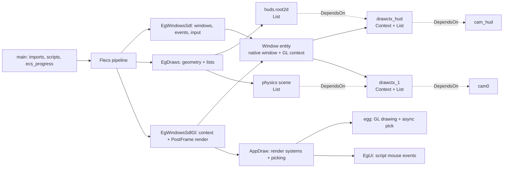
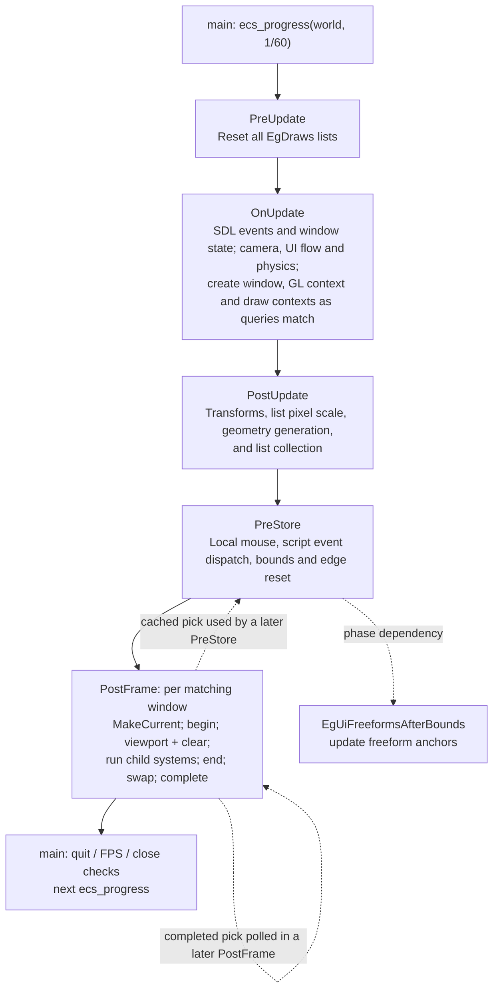

# app1 graphics framework: current behavior and design review

Status: **as-built investigation with proposals**, not an implemented API.
This describes the checked-in code plus the current working-tree changes in
`joints2`. App1 is an experiment for a Flecs graphics framework; this document
is a starting point for changing the design later, not a request to change code
now. The [frame timeline](frame-timeline.md) is the starting sketch; where it
implies an order not established below, this document does not assume it.

## Fundamental problem

A frame must transform ECS state into draw data, render each window with the
correct OpenGL context current, present it, and deliver input using valid
window and picking state. GL resources must be created, used, and destroyed
with their owning context current. Flecs systems should express the data flow
without making the SDL backend know application drawing details or allowing
unrelated systems to run accidentally inside a window's GL scope.

## Current topology



`ChildOf` and `DependsOn` have different roles. Draw contexts are children of
the window and depend on cameras. Scene/UI roots own lists and depend on draw
contexts; drawable descendants find a list by `ChildOf`. `AppDrawContext_Collect`
appends source lists to a context list via `DependsOn`. See
[windows.flecs](config/windows.flecs), [cameras.flecs](config/cameras.flecs),
[huds.flecs](config/huds.flecs), and [physics.flecs](config/physics.flecs).

## Current frame

The arrows between phases below represent the pipeline's phase sequence, not a
promise that every operation within a phase is ordered as drawn. In
particular, the timeline sketch's `~~~` links are layout aids, not ordering
constraints. The custom freeform phase depends on `PreStore`; its exact
position relative to other phases should be verified against the active pipeline.



- `main` imports modules, loads the configuration, and progresses with a
  supplied fixed delta of 1/60. FPS and close/quit checks happen after
  `ecs_progress`; see [main.c](src/main.c).
- `EgWindowsSdl` polls SDL into a world-wide button singleton and focused-window
  singleton, and refreshes each window's logical and framebuffer dimensions,
  focus, visibility, and mouse position. Window and GL creation are immediate
  `OnUpdate` systems; draw contexts are created when their window context
  matches. The SDL backend requests OpenGL 4.3 core.
- In `PostUpdate`, `EgDraws` generates solid, border and text vertices with
  entity indices and layers, and `AppDraw` appends lists into draw-context
  lists. The sketch describes intended producer/consumer order; shared phase
  membership alone is not an explicit dependency between these systems.
- In `PreStore`, the picker reads the previously cached result and
  `EgUiScriptEvents_Emit` sends aggregated button state to Flecs script input.
  Local mouse and bounds systems also run in this phase. The code does not
  declare a separate phase ordering event dispatch, local mouse, and bounds;
  `EgUiFreeformsAfterBounds` explicitly depends on `PreStore`.
- The pick submitted in a window's `PostFrame` cannot be used by that frame's
  earlier `PreStore`. A later `PostFrame` polls it, and a still later
  `PreStore` can dispatch it. GPU completion can add further delay; the last
  valid result remains cached while a new one is pending.

### Per-window GL scope

```mermaid
sequenceDiagram
    participant P as Flecs PostFrame
    participant W as SDL GL window backend
    participant A as AppDraw frame callbacks
    participant R as Window child systems
    participant G as egg / GPU
    P->>W: System_Render(window)
    W->>W: SDL_GL_MakeCurrent(window, context)
    alt MakeCurrent fails
        W->>A: complete(window, false), if installed
    else Context current
        W->>A: begin(window), if installed
        A->>G: poll previous pick; optionally begin new pick
        W->>W: viewport and clear color buffer
        W->>R: ecs_run each child EcsSystem in window group
        R->>G: lazy renderer init; draw list and optional pick
        R->>R: clear rendered list
        W->>A: end(window), if installed
        A->>G: finish pick submission if started
        W->>W: SDL_GL_SwapWindow
        W->>A: complete(window, displayed), if installed
        A->>G: accept or invalidate submission
    end
```

`System_Render` queries windows with `EgWindowsWindow`,
`EgWindowsOpenGLContext`, and `EgShapesRectangle`; it loops over them and does
not restore the previously current GL context after rendering. Its context
holds a query for **all** `EcsSystem` children grouped by `ChildOf`; it runs
each with `ecs_run(..., 0.0f, NULL)`. No explicit child-system ordering is
declared. This differs from a Flecs phase running the child systems as normal
pipeline systems. See
[EgWindowsSdlGl.c](../../vendor/eg/EgWindowsSdlGl/src/EgWindowsSdlGl.c)
and [AppDraw.c](src/AppDraw.c).

## Current ownership, input and failure contracts

| State / resource | Current owner and behavior |
| --- | --- |
| SDL window | `EgWindowsWindow.object`; SDL event IDs are mapped to ECS entities. |
| GL context and child-system query | `EgWindowsOpenGLContext` on the window. It also exposes a backend cleanup function. |
| Renderer | `AppDrawContext` on each draw context. `egg_render_init` is lazy, inside `Test_Render` under the current window context. Failure logs, clears the list and disables the draw entity. |
| Draw lists | `EgDraws_List` on source roots and draw contexts; reset at `PreUpdate`, appended during `PostUpdate`, and context lists cleared after draw. |
| Pick state | `AppDrawPickState` on an opted-in window, initialized when a draw context is created while `GpuPicking` is present. One `EgWindowsFrameCallback` component supplies begin/end/complete callbacks. |
| Script input | A world-wide `EgUiScriptEventsPicker` singleton and world-wide Flecs script event hooks; enabling picking during context creation installs AppDraw's `to_local` hook, replacing existing hooks. |

AppDraw removal observers destroy pick and renderer resources through the GL
cleanup function. The SDL implementation saves the previous current window and
context, makes the owning context current, invokes destruction, then attempts
to restore the previous context. Restoration can fail **after** destruction,
so resource callbacks clear their own pointers. The native window and context
must remain valid through component removal and must not be replaced on the
same entity. Normal production teardown of the SDL window, GL context and
`inner_systems` query is not present in the inspected backend; tests explicitly
destroy these resources. This is a lifecycle gap to resolve, not an ownership
guarantee.

Picking is optional and has no CPU fallback. On a valid focused window it maps
logical mouse coordinates to framebuffer pixels, polls completed submissions
and starts another if a slot is free. There are three asynchronous slots;
busy slots cause a skipped submission. Only live, enabled
`eg.ui.script.events.Target` entities are eligible. Visible and pick geometry
share a draw pass; the smallest window-space depth wins, with later primitives
breaking exact ties, which need not match visible topmost order. The draw list
contains entity indices, resolved to full IDs for pending results at
submission; index reuse before submission is still a limitation. Results are
revalidated before dispatch. Invalid focus/window/size or a resize invalidates
cached/pending picks. Failure or missing required GPU extensions is logged and
marks picking unavailable for that state. See [README.md](README.md) and
[egg.c](../../vendor/egg/src/egg.c).

Resize handles may opt into script-level capture. It is bounded to the window:
loss of focus, leaving the window, disabling the target, and other invalidation
conditions cancel it. This is not SDL outside-window mouse capture. Ordinary
buttons do not capture; a release over the background may not reach the
pressed entity. See [EgUiScriptEvents.c](../../vendor/eg/EgUi/src/EgUiScriptEvents.c)
and [README.md](README.md).

## Audit: issues and opportunities

These are observations or risks in the existing design, not claims that a
replacement has already been implemented.

1. **Render systems overlap.** `AppDrawContext_Create` creates one child system
   per draw context, but each generated system's query matches *all* draw
   contexts under that window, not the context that named it. With two contexts,
   both systems iterate both contexts; the first clears their lists, so later
   passes can encounter empty lists. Work and behavior depend on iteration
   order. The existing render-cycle test constructs only one context/system.
   Prefer one render system per window, or a genuinely context-specific query;
   choose and test ordering explicitly.
2. **Any child system is treated as GL work.** Parenting a system to the window
   silently opts it into manual execution. Its query, order, enabled state, and
   timing need an explicit contract; a `ChildOf` relationship alone mixes
   hierarchy with execution membership. Consider an explicit render-stage
   membership and order instead.
3. **Frame ordering is implicit.** List production, collection and transforms
   share `PostUpdate`; event emission, local coordinates and bounds share
   `PreStore`. The relevant data dependencies and registration/order behavior
   need verification under Flecs, especially if modules or systems are added.
   UI mutations after geometry generation cannot affect already generated
   vertices in that frame. Specify intended same-frame versus next-frame
   behavior before reorganizing phases.
4. **Lifecycle responsibilities are split.** Renderer/pick observers depend on
   valid native handles and backend cleanup, but the inspected production
   backend has no corresponding normal destroy path for windows, contexts or
   per-context queries. Establish one owner and a deterministic teardown order;
   avoid inventing a second cleanup mechanism around the existing one.
5. **Picking setup is coupled to draw-context creation.** Adding `GpuPicking`
   after contexts already exist does not itself install the pick state or
   callbacks; a single callback component and global script hooks also make
   composition with other consumers difficult. Decide whether picking is
   creation-time only or a dynamically configurable window feature. Make hook
   ownership/composition explicit rather than silently replacing other users.
6. **Frame and input snapshots differ.** Picking is asynchronous, uses
   frame-aggregated buttons and can use a result for an older pointer position.
   Press/release in one poll interval, focus transitions, resize, and captured
   versus ordinary release need defined semantics. Decide whether stale hits
   are acceptable for hover, press, and release separately.
7. **Two coordinate sources deserve review.** Window state uses SDL's focused
   mouse coordinates, while window mouse entities use global mouse position
   minus window position; normalized unprojection uses logical size, while
   viewport and camera rectangle use framebuffer size. Verify high-DPI,
   multi-window and coordinate consistency rather than assuming equivalence.

## Candidate direction for a later revision

This is a design hypothesis, not a change to the as-built contract:

1. Make a window render operation the single owner of the GL-current scope:
   make current, run explicitly selected ordered render work, present, and
   report success/failure. Keep SDL calls in the backend.
2. Represent each draw context once as data: window, camera, list, renderer.
   Use one window-level traversal or explicitly scoped work items, not one
   identical all-context query per context. Define ordering across cameras and
   layers before selecting an implementation.
3. Define named producer/consumer boundaries: input snapshot and simulation;
   layout/transforms; draw preparation; input dispatch; per-window rendering.
   Decide how interaction-driven layout changes appear in the rendered frame
   before specifying the exact phase order.
4. Give each resource a single owner and define creation, removal, failure,
   context-current destruction, and native teardown as one lifecycle. Make
   per-window features such as picking explicit and composable.

Delete or replace redundant generated render systems, implicit child-system
dispatch, or callback plumbing **only after** the replacement responsibilities
and consumers are established; do not add another adapter layer merely to hide
them. The appropriate Flecs API (custom phases, explicit `ecs_run`, or another
mechanism) remains an open design decision.

## Decisions and acceptance checks for code work

Open decisions: required render order for HUD versus scene; whether arbitrary
third-party render work is supported; GL thread/current-context and
multi-window rules; whether picking can be toggled at runtime; stale-result and
button-release semantics; and the desired same-frame layout/input behavior.

Before a later refactor is complete, verify:

- Two draw contexts in one window and contexts in two windows each render once
  per frame, in the chosen order, with the correct context current; unrelated
  child systems do not run as render work.
- Creation failure, make-current failure, failed swap, disable/removal and
  teardown produce explicit outcomes and do not use or destroy resources with
  the wrong or already-destroyed context. Verify previous-context restoration
  where the chosen contract requires it.
- List generation, collection, input/local coordinates and interaction-driven
  geometry updates obey the chosen frame boundaries, including first frame.
- Picking covers unsupported extensions, busy slots, delayed completion, swap
  failure, resize, focus loss, deletion/reuse, and runtime enable/disable if
  supported. Test ordinary and captured press/drag/release, including
  background and cancellation, and high-DPI/multiple windows.
- Existing focused tests in
  [Snapshot.c](test/AppDraw_test/src/Snapshot.c) and
  [Picking.c](../../vendor/egg/test/egg_test/src/Picking.c) remain useful, but
  add multi-context/order and lifecycle tests for the chosen contract. GPU
  tests may skip picking checks when the required extensions are unavailable.
